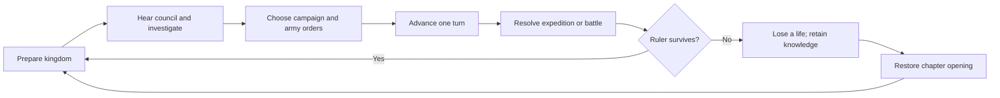

# GAME OF CAT: War of the Nine Lives

Design and implementation handoff · Version 1.0 · 11 October 2026

## 1. Purpose and instructions for Codex

Build a fun, visually rich browser strategy adventure using the existing Game of Cat project's character designs. This document is the product specification and implementation roadmap. Start with a complete playable chapter, test its decisions and combat, then expand it into a campaign.

Read this document before implementation. Inspect the repository and its instructions, preserve existing work, and adapt the proposed stack to anything already established. Implement working gameplay, not a landing page or a decorative dashboard. Work through the phases in order and leave a concise record of completed work, verification, known limitations, and the next phase.

No repository URL was provided when this document was written. It has been prepared locally for the user to add to the root of their GitHub repository. No repository changes, deployment, or contest submission have been performed.

### Confirmed requirements

- Exact title: **GAME OF CAT: War of the Nine Lives**.
- Runs in a web browser and will be built with Codex.
- Created in connection with the Game of Cat creator contest.
- Use the project's existing characters and recognisable designs, not substitute original cat heroes.
- Prioritise fun, engagement, and visual quality. Do not impose a rushed contest-sized scope.
- User has agreed to begin after the proposed kingdom, council, campaign, combat, and nine-lives gameplay explanation.

### Design defaults

The mechanics, values, chapter names, scenarios, abilities, and narrative connections below are proposed game design. They are not assertions about official Game of Cat lore. Codex may tune numbers and routine implementation details while preserving the core experience. Material changes to genre, cast appearance, business model, or multiplayer scope should be discussed with the user.

## 2. The player promise

**Rule a kingdom of cats. Command its armies. Uncover the betrayal. Use nine lives to change its fate.**

The player is the crowned ruler. They govern their capital, hear the council, move armies across a regional map, and command short tactical battles. Death rewinds the active chapter but preserves discovered knowledge. A successful run comes from understanding characters, recognising threats, and making better decisions—not from repeating chores.

### Experience pillars

1. **Every turn presents a meaningful choice.** Limited resources force tradeoffs, but no option is consistently best.
2. **Characters drive strategy.** Trust, evidence, and promises influence alliances and available actions.
3. **Preparation becomes visible in combat.** Walls, troop composition, scouting, and positioning change battles.
4. **Death reveals something useful.** A lost life adds knowledge and a faster route through familiar events.
5. **The world rewards attention.** Cat behaviour supplies occasional humour inside an otherwise dramatic medieval setting.

### Scope

Initial release: single-player campaign, local saves, three substantial chapters, several endings, and replayable combat challenges. Desktop is the primary target; touch and smaller screens receive appropriate controls and layouts.

Later possibilities: optional accounts, cloud saves, additional chapters, challenge leaderboards, localisation. Multiplayer, persistent MMO infrastructure, wallet connections, token purchases, and financial mechanics are not part of the initial implementation.

## 3. What the player actually does

### Main loop



Each strategic turn contains kingdom actions, one significant council decision, and optional campaign orders. Pressing **Advance Turn** produces a readable resolution: income, upkeep, construction progress, travel, events, and threats. The player can inspect everything before committing.

### Example ten-minute sequence

1. A brief funeral scene introduces a missing royal seal and a warning from the North.
2. The player chooses between repairing the gate and funding a scout patrol.
3. The Queen asks for palace guards; the Northern Lord asks for reinforcements.
4. The player assigns an army on the regional map and advances the turn.
5. An intercepted messenger reveals a clue and a new investigation option.
6. A battle begins at a mountain pass. The player deploys infantry and archers, flanks with cavalry, and times a commander ability.
7. Victory returns soldiers and supplies, but the palace's security reflects the earlier guard allocation.
8. The ruler survives the chapter or dies to a foreshadowed betrayal. If they die, the journal explains what was learned and offers a clear restart.

No long mandatory building timers, energy system, daily-login dependency, or forced resource grinding.

## 4. Kingdom management

### Presentation

An angled 2D castle scene is the home screen. Buildings are clickable, guards patrol, banners move, and environmental effects establish weather and time of day. Detailed portraits appear in dialogue and commander panels. Use a layered environment with parallax and effects rather than assuming full 3D is necessary.

### Resources and state

| Resource / state | Purpose | Player-facing consequence |
| --- | --- | --- |
| Gold | Construction, recruitment, diplomacy | Spending on one priority delays another |
| Food | Army upkeep, relief, expedition supply | Shortage lowers readiness before causing attrition |
| Materials | Walls and building upgrades | Securing supply routes supports defence |
| Army strength | Available squads and readiness | Deploying troops leaves fewer defenders at home |
| Public order | Stability and support | Low order causes strikes, unrest, or difficult events |
| Character trust | Relationships and promises | Changes cooperation, information, and alliance options |
| Lives | Campaign-wide remaining attempts | Death consumes one; progress can be saved and resumed |

Trust is shown as understandable categories such as Wary, Neutral, Cooperative, and Loyal. Internally it may be numeric. Do not claim a trust score proves innocence; evidence and motivations remain separate.

### Initial buildings

| Building | Actions | Strategic purpose |
| --- | --- | --- |
| Keep | Enter council, inspect guards, review threats | Home defence and story |
| Barracks | Recruit squads, assign reserves | Army composition |
| Granary | Improve storage and food income | Sustained campaigns |
| Gate and walls | Repair and upgrade defences | Siege resilience |
| Workshop | Produce materials, upgrade equipment | Long-term investment |
| Watchtower | Scout routes and warn of attacks | Information advantage |

First chapter uses three upgrade levels at most, with visibly different building states. Start with four accessible buildings and introduce the others as needed.

### Strategic action rules

- Default: two kingdom actions per turn. Recruitment, repairs, construction starts, and selected investigations consume actions.
- Council choices do not consume kingdom actions; their stated costs still apply.
- Army movement orders are free to issue, but travel consumes turns and supply.
- Preview costs and completion time before commitment. Allow undo of uncommitted selections.
- A one-turn building upgrade means completion when the next turn resolves, not after a real-world wait.
- Warn about projected food shortage and low palace defence before advancing.
- Shortages escalate over multiple turns. A single mistake should create a recoverable problem rather than an unexplained game over.
- All starting values and costs belong in balance data, not scattered through UI components.

## 5. Council, characters, and investigations

Each council scene offers two to four substantial choices. Show known costs and likely immediate effects while preserving genuine uncertainty. A choice can add a promise, alter trust, move troops, trigger a clue, or unlock a mission.

Choices need contextual consequences. Refusing a request after discovering evidence should differ from refusing without explanation. Previous discoveries unlock new dialogue and preparation options, not a single glowing 'correct answer'.

### Character design source of truth

Source video: `game of cat.mp4`, approximately 140 seconds, 1920 × 1080. Original local source was `C:/Users/HP/Downloads/game of cat.mp4`. The game must use portable repository asset paths; never require this machine-specific path at runtime.

Working labels below are not verified official names:

| Working label | Identity details to preserve | Source frame |
| --- | --- | --- |
| Crowned ruler | Brown tabby face; gold crown; black fur mantle; elaborate black-and-gold clothing and jewellery | 00:30 |
| Royal cat / Queen candidate | Orange fur; long golden hair; green-toned eyes; red-jewelled gold crown; red-and-gold gown | 00:35 |
| Northern Lord candidate | Grey-brown tabby; yellow-green eyes; heavy dark fur cloak; leather clothing; round metal brooch | 01:40 |
| Northern companion | Orange-brown feline; reddish hair; dark blue dress | 00:45 |
| Dragon Queen candidate | Pale cream/orange feline; blue eyes; long pale braids; burgundy clothing and cape; round gold clasp | 01:55 |
| Bovine court figure | Brown-and-white bovine head; horns; ornate dark robe; heavy gold chain and pendant | 00:10 |
| Snow rider / antagonist candidate | Dark weathered armour; concealed face; dark horse; snowy environment | 02:10 |

Do not turn the bovine character into a cat or invent official names. Confirm character identities against project material when available. The earlier assumption that all major characters were cats was incorrect; the supplied video includes a bovine court figure.

### Proposed gameplay roles

- Ruler: player avatar and strategic decision maker.
- Queen: palace influence and domestic politics.
- Northern Lord: frontier defence and military warnings.
- Northern companion: possible diplomatic or intelligence role; confirm before defining permanent lore.
- Dragon Queen: alliance, special reinforcements, and later campaign choices.
- Bovine court figure: possible treasury or council role; currently unverified.
- Snow rider: late-campaign threat; nature and identity unverified.

### Evidence journal

Each clue records what was actually observed, source, chapter, and unlocked options. Separate confirmed evidence from suspicion. The journal is searchable by character or chapter once its size justifies filters. New clues receive a restrained notification and a clear entry point.

## 6. World map and campaigns

The first map is a fictional regional network, not a huge open world. Use six to eight locations with visible connecting routes: capital, food-producing village, watchtower, mountain pass, Northern stronghold, forest shrine, and optional camp. Location names are provisional.

Clicking a location shows ownership, travel time, scouted threats, rewards, and available actions. Unknown enemy composition remains marked unknown. Scouting reveals useful information and sometimes an alternate route.

- Armies move along connected routes and cannot occupy multiple locations at once.
- A travelling force still consumes food.
- Palace reserves are explicit squads, not an invisible defence number.
- Missions include escort, rescue, defend, investigate, negotiate, and capture.
- Some missions resolve through decisions; major conflicts enter tactical combat.
- Captured locations provide distinct benefits; avoid identical resource nodes.
- Returning troops retain casualties and readiness until recovery.

## 7. Tactical combat

### Core rules

Short real-time battles with pause and deployment. Target duration: approximately two to five minutes once learned. The player controls squads rather than individual soldiers. Begin with three friendly squad types and one commander.

| Squad | Strength | Weakness | Role |
| --- | --- | --- | --- |
| Infantry | Holds positions and protects allies | Slow; vulnerable to sustained ranged fire | Front line |
| Archers | Ranged damage from safe positions | Weak when engaged at close range | Rear support |
| Cavalry | Fast movement and strong charges | Poor into braced infantry and narrow terrain | Flanking |

Terrain and position matter more than a rigid rock-paper-scissors bonus. Infantry can brace; archers benefit from protected high ground; cavalry needs space to charge. Scouting informs deployment.

### Commands

- Select squad; move or attack a visible target.
- Hold position, brace, regroup, and retreat.
- Pause/resume and issue orders while paused.
- Activate one commander ability with a clear cooldown and range.
- Default speed 1×; optional 2× for familiar fights.
- Keyboard shortcuts supplement all visible controls. Touch users receive tap-select and explicit command buttons.

First ability proposal: **Rally** restores nearby morale and temporarily improves resistance to routing. Later commanders can introduce distinct abilities. Dragons should arrive as a dramatic, constrained late-game reinforcement rather than making early battles trivial.

### Battle readability

Friendly and enemy factions use stable colours plus banners or shapes. Health and morale appear on selection or damage. Show clear projectile paths, readable ability effects, and obvious squad routing. Avoid covering the battlefield in permanent numbers.

### AI

Initial enemy behaviour: advance, prioritise reachable threats, protect ranged squads, react to flanks, and retreat at low morale. Use deterministic decisions where possible. Units cannot attack through walls or overlap indefinitely. Unreachable targets must be abandoned or repathed. Full formation simulation is optional; reliable squad movement is mandatory.

### Results

Show objective outcome, casualties, supplies spent, rewards, and the effect on the next turn. Strategic defeat may cost territory without killing the ruler. Only a ruler-death event consumes a life. A protected ruler can retreat from a lost battle.

## 8. Nine lives, rewind, and fairness

Lives are campaign-wide. Completing a chapter creates the next chapter checkpoint. Death restores the active chapter's opening state and consumes exactly one life. Completed chapters remain completed. Discovered knowledge and seen-scene flags survive rewinds; ordinary resources, armies, relationships, and construction revert to the checkpoint.

### Persistent across rewinds

- Lives remaining.
- Discovered evidence and journal entries.
- Seen dialogue/cinematics, enabling skip and fast presentation.
- Completed chapters and unlocked challenge modes.
- Settings and accessibility preferences.

### Reset on rewind

- Current chapter turn and ordinary story flags.
- Resource totals, building levels, army positions, casualties, and readiness.
- Chapter-specific trust changes, promises, and mission outcomes.

### Death design

Every lethal outcome needs advance clues or a visible risk, an understandable causal chain, and useful information on the death screen. Do not kill the ruler through arbitrary hidden dice rolls. Replaying the same choices with the same seed produces the same result; changed decisions alter the outcome.

After death show: what happened, which earlier action contributed, what evidence was learned, and lives remaining. Offer **Rewind Chapter** and **Return to Menu**. A death cannot repeatedly decrement lives during reload or double-clicks.

At zero lives, end the run, retain its journal as an archive, and offer a fresh campaign. Optional story-assist mode allows unlimited rewinds and is clearly labelled. Manual restarting a chapter costs no life but grants no new death discovery. This is a single-player game: do not add anti-cheat infrastructure to police personal experimentation.

## 9. Campaign and progression

### Chapter I — The Missing Seal (working title)

Teach kingdom actions, council decisions, scouting, one expedition, and one battle. Target six to eight strategic turns. Include at least two viable survival strategies and multiple evidence routes. The central threat is a palace conspiracy, supported by warnings rather than an unavoidable surprise.

### Chapter II — The Northern Warning (working title)

Introduce supply routes, simultaneous threats, fortification battles, and a difficult alliance. Carry meaningful chapter-I outcomes forward, with bounded starting advantages or disadvantages. No earlier choice may make the chapter unwinnable without warning.

### Chapter III — Fire Beyond the Crown (working title)

Introduce the Dragon Queen alliance and the northern supernatural threat as proposed adaptations of trailer themes. Combine a final council decision, a large but readable battle, and an ending based on evidence, alliances, and survival.

### Endings

At least three: united realm, costly survival, and fractured victory. Losing all lives is a separate defeat ending. Endings acknowledge major choices and remaining lives without requiring one perfect solution. Keep the exact story original to this fan game and mark departures from established lore.

### Replay value

Different viable alliances, army compositions, investigation routes, optional objectives, and seeded challenge battles. Add difficulty presets through transparent changes to resources, enemy composition, and hints. Do not increase difficulty through input speed or unreadable effects.

## 10. Making it fun

Engagement comes from interesting decisions, anticipation, visible consequences, and discovery. Rewards should arrive as new options, useful clues, changed environments, and satisfying victories.

### Design safeguards

- First meaningful decision within approximately one minute of starting.
- First battle within the first ten minutes, unless the player deliberately explores.
- Every turn introduces a new development or resolves something previously planned.
- At least two plausible options in major decisions; avoid one obviously superior choice.
- Familiar dialogue is skippable. Repeated chapter setup becomes faster after a rewind.
- Loss creates a new plan rather than demanding the same actions again.
- Tactical abilities create dramatic moments but have clear counterplay and cooldowns.
- No permanent reward for endlessly farming an easy encounter.
- Cat humour is occasional and characterful: distracted guards, ceremonial objects pushed off tables, unreasonable fish demands. Avoid turning every line into a pun.

### Playtest questions and release gates

Ask new players: What was your goal? Why did you choose that option? What caused the loss? What would you try next? Which moment was exciting? Where did you stop caring?

For the first chapter, test with at least three people unfamiliar with the game when possible. Proceed to campaign expansion only when players can explain the main objective, understand a defeat, and describe a different strategy they want to try. Record qualitative findings; invented retention percentages are not evidence of fun.

Track optional local development events such as first decision, battle started, battle completed, death cause, rewind, and chapter completion. Do not transmit analytics without a deliberate product decision.

## 11. Screen and interaction design

### Screen inventory

1. Title and menu: Continue, New Campaign, Challenges when unlocked, Settings, Credits.
2. Kingdom: living castle, resource bar, available actions, building interactions, next-turn preview.
3. Council: character portrait, dialogue, options, known consequences, journal access.
4. Regional map: routes, armies, objectives, location details.
5. Battle preparation: enemy intelligence, terrain, squad placement, commander.
6. Battle: readable field, pause, selection, commands, ability, objective.
7. Battle results: casualties, rewards, strategic consequences.
8. Journal: evidence, memories, chapter recap.
9. Death and rewind: cause, clue, lives, chapter restart.
10. Chapter completion and endings.

### Layout sketch

```text
┌──────────────────────────────────────────────────────┐
│ Chapter / Turn    Gold · Food · Materials    Lives 9  │
├──────────┬───────────────────────────────────────────┤
│ Kingdom  │                                           │
│ Council  │       CASTLE / MAP / BATTLE SCENE           │
│ Map      │                                           │
│ Journal  │      Click a building or select a squad    │
├──────────┴─────────────────────────┬─────────────────┤
│ Objective / selected item details  │ Advance Turn    │
└────────────────────────────────────┴─────────────────┘
```

The drawing describes placement, not final artwork. During combat replace strategic navigation with battle controls. On phones move primary navigation below the scene; use drawers for details. Battle supports landscape and a usable portrait fallback. Never shrink a desktop interface until its text becomes unreadable.

### Accessibility

Readable body font; decorative serif for short titles only. Keyboard-accessible menus, visible focus, sufficient contrast, text scaling, subtitles, adjustable music and effects, mute, reduced motion, and no colour-only indicators. Never force audio autoplay. Offer pause and avoid rapid flashing. Portraits and cinematic scenes receive meaningful text alternatives; DOM controls remain accessible even if the world uses canvas.

## 12. Visual and audio production

### Art direction

Realistic anthropomorphic animals; detailed fur, metal, and cloth; dark stone castles; warm candles; snowy northern landscapes; burgundy textiles; restrained gold ornament. Preserve the project characters' identity in every portrayal. Use their source frames as the visual authority.

### Reference package

The prepared package contains:

- `trailer-contact-sheet.jpg`
- `crowned-ruler-and-royal-cat.png`
- `royal-cat-closeup.png`
- `northern-lord-and-companion.png`
- `northern-lord-closeup.png`
- `dragon-queen-closeup.png`
- `dragon-queen-and-dragon.png`
- `snow-rider.png`
- `bovine-court-figure.png`

The files are stored directly in `docs/references/`. Keep them in that location. Source frames are reference material; they do not constitute sprite sheets, cutout portraits, or rigged models. Do not silently present rough crops or generic emoji as finished character assets.

### Asset workflow

1. Inventory source material and record visible features; leave unseen details unknown.
2. Obtain the project's supplied character art or sheets if available. Record provenance and applicable use terms in the asset manifest.
3. Make a reference sheet per character. Compare faces, markings, eyes, hair, crown, costume, jewellery, proportions, and silhouette against original frames.
4. Create portrait expressions and gameplay adaptations using image references. Generation cannot guarantee an exact match; inspect and revise each important image.
5. Define camera angle, sprite scale, and animation requirements before creating troop assets.
6. Build a cohesive castle/environment kit with consistent perspective and light.
7. Export web-ready images, atlases, audio, and metadata; retain source masters outside the runtime bundle.

### First chapter asset list

| Category | Minimum useful set |
| --- | --- |
| Main portraits | Ruler, Queen candidate, Northern Lord, bovine council figure; neutral plus one useful expression each |
| Environment | Castle base; four interactive buildings; gate damage states; council backdrop; regional map; one battlefield |
| Troops | Infantry, archers, cavalry; idle, move, attack, hurt, routed/defeated states |
| Interface | Resource icons, faction emblems, selection markers, ability icon, journal clues |
| Effects | Projectiles, impact, rally, fire, snow, restrained ambient particles |
| Audio | Menu/kingdom loop, council ambience, battle loop, victory/defeat cues, UI and combat effects |

Keep generic troops visually consistent with the world; do not imply every soldier is a unique official character. Named commanders must preserve the approved project designs.

Use licensed/original music and effects. Do not assume trailer music is separately available or cleared for game use. Start with sound effects and ambience; voice acting can follow once script and cast identities are stable.

### Asset manifest

For every asset record ID, path, source, creator/tool, reference character, use terms/status, dimensions, animation states, and approval status. Missing final art is tracked explicitly. Temporary art may support development but must not pass the visual release gate.

## 13. Proposed technical architecture

Default for an empty repository: TypeScript, Vite, React for menus and strategy panels, Phaser 3 for castle/world scenes and tactical combat, Vitest for game rules, and Playwright for essential browser flows. Pin actual compatible package versions during setup after checking current documentation. If the repository already has a suitable stack, prefer extending it.

### Boundaries

- **Game rules:** pure state transitions, resources, turn resolution, evidence, missions, trust, rewind, and campaign progression.
- **Content:** typed character, chapter, dialogue, mission, building, unit, and balance definitions.
- **Presentation:** React screens and Phaser scenes consuming state and issuing commands.
- **Persistence:** versioned saves, migrations, export/import, settings.
- **Audio/assets:** loaders and playback with explicit lifecycle ownership.

React must not rerender on every combat frame. Phaser owns transient movement/rendering; the combat engine publishes meaningful changes and a final result. One authoritative game state prevents UI and scene disagreement. Communicate with a small typed command/event interface rather than a collection of shared mutable globals.

### Suggested structure

```text
DESIGN.md
README.md
docs/
  references/
  asset-manifest.json
  playtests.md
  progress.md
public/assets/
  portraits/ environments/ troops/ ui/ effects/ audio/
src/
  game/
    state.ts
    commands.ts
    turn.ts
    campaign.ts
    evidence.ts
    rewind.ts
    combat/
  content/
    characters/ chapters/ dialogue/ missions/ balance/
  scenes/
    KingdomScene.ts
    MapScene.ts
    BattleScene.ts
  ui/
    screens/ components/
  services/
    saves.ts
    audio.ts
  main.tsx
tests/
```

### State model

```ts
type GameSave = {
  version: number;
  runId: string;
  persistent: {
    livesRemaining: number;
    evidenceIds: string[];
    seenSceneIds: string[];
    completedChapterIds: string[];
    difficulty: 'story' | 'standard' | 'hard';
  };
  checkpoint: ChapterState;
  chapter: ChapterState;
  pendingBattle?: BattleSnapshot;
  processedOutcomeIds: string[];
};

type ChapterState = {
  chapterId: string;
  turn: number;
  seed: number;
  resources: { gold: number; food: number; materials: number };
  publicOrder: number;
  buildingLevels: Record<string, number>;
  armies: ArmyState[];
  trust: Record<string, number>;
  flags: Record<string, boolean>;
  queuedProjects: ProjectState[];
  activeMissions: MissionState[];
};
```

These are interface sketches; define the omitted types before use. Keep settings separate from campaign saves. Stable IDs, explicit conditions, and schema validation prevent broken narrative links.

### Turn resolution

1. Validate and commit queued player actions exactly once.
2. Complete projects due this turn and resolve scheduled movement.
3. Apply income and upkeep according to documented order.
4. Apply readiness/shortage effects and noncombat mission outcomes.
5. Select eligible narrative events using explicit priority and seeded randomness where suitable.
6. Queue battles in a stable order; resolve each before finalising the turn.
7. Evaluate ruler death and chapter completion.
8. Save the committed state and show a resolution summary.

Specify whether income from newly completed buildings applies immediately; choose one rule and preview it correctly. At most one major council event per turn. Important story events cannot be randomly skipped.

## 14. Saves, reliability, and performance

Start with IndexedDB/local storage through a versioned persistence service. Offer save export/import so browser storage clearing need not permanently erase a campaign. Validate imports and reject malformed or incompatible files with a helpful message.

Autosave after committed turns, dialogue decisions, battle entry/result, deaths, rewinds, and chapter transitions. A pending battle stores a reproducible entry snapshot. If mid-battle saves are not supported initially, clearly resume at battle start with identical state and seed. Do not duplicate rewards or life losses after reload.

Handle missing/corrupt saves, unavailable browser storage, failed asset loads, and scene teardown. Provide retry or recovery without an empty screen. Pause combat on page visibility loss.

Performance targets are provisional: smooth 60 fps on a typical desktop, usable 30 fps on modest devices, compressed initial critical assets around 10 MB or less where practical, and progressive loading of later chapters. Measure actual payload and frame times. Use atlases, capped particles, and scalable detail. Do not preload the 73 MB trailer as a required game asset.

## 15. Implementation roadmap

### Phase 0 — Repository and reference preparation

- Inspect repository instructions and existing code.
- Place this file at repository root; add portable reference assets and provenance manifest.
- Choose the stack; establish dev, build, type-check, and test commands.
- Create a minimal boot flow, settings, and clear asset-loading errors.

**Done when:** a fresh checkout can run locally, and required character reference files are present without machine-specific dependencies.

### Phase 1 — Playable rules prototype

- Implement state, two-action turns, resources, four buildings, recruitment, council choices, journal, and six-location map.
- Build chapter-I events as data with explicit prerequisites and consequences.
- Use plainly labelled temporary visuals where necessary.
- Add save/load, checkpoint, death, and rewind.

**Done when:** the player can make choices, advance turns, uncover a clue, die, rewind with that clue, and survive through a different strategy.

### Phase 2 — Tactical battle prototype

- Build one battlefield, deployment, three squad types, movement, targeting, morale, pause, retreat, and Rally.
- Connect army state to combat entry and casualties to results.
- Implement reliable enemy behaviour and obstacles.

**Done when:** placement and commands materially affect outcome; results persist once; retreat can preserve the ruler.

### Phase 3 — Complete first chapter

- Connect funeral opening, kingdom, council, map, battle, betrayal, and ending.
- Add tutorial prompts at the moment an action becomes useful.
- Support at least two viable survival approaches and skippable repeated scenes.
- Conduct initial playtests and revise dominant strategies or confusing losses.

**Done when:** the complete loop is understandable and players want another attempt. Do not expand a dull loop just because its code works.

### Phase 4 — Visual and audio production

- Approve reference-based character likeness, castle environment, map, and battlefield.
- Replace temporary assets; add animation, lighting, weather, sound, and transitions.
- Make chapter-I screens cohesive and readable at desktop and phone sizes.

**Done when:** character designs match the supplied references, no development placeholders remain in the chapter, and presentation supports gameplay clarity.

### Phase 5 — Campaign expansion

- Add chapters II and III, new locations, alliance consequences, dragon reinforcement, and final threat.
- Add endings, optional objectives, challenge battles, and difficulty presets.
- Test carryover state and ensure every supported chapter entry is recoverable.

**Done when:** a full campaign can be completed and multiple strategies/endings work without narrative contradictions or softlocks.

### Phase 6 — Release preparation

- Accessibility, responsive layouts, audio controls, performance, save export/import, recovery, and credits.
- Playtest with unfamiliar players; address major confusion and pacing issues.
- Produce gameplay screenshots and a short trailer from actual implemented play.
- Prepare static hosting build and deployment instructions. Publish when authorised.

**Done when:** release checks below pass and limitations are documented.

## 16. Verification and acceptance criteria

### Meaningful rules tests

- Costs and actions cannot be overspent; values obey their documented ranges.
- Income, upkeep, construction, movement, and events resolve in the intended order.
- Invalid commands leave the state unchanged and explain why.
- Same seed and commands yield the same outcome where determinism is promised.
- Clues survive rewinds; ordinary chapter state resets; completed chapters remain.
- A death costs one life exactly once, including after reload or duplicate input.
- Battle casualties/rewards apply exactly once; retreat differs from ruler death.
- Missing dialogue targets, duplicate IDs, impossible prerequisites, and broken asset references fail validation.
- Saving/loading preserves progression; unsupported versions and corrupt data fail gracefully.

### Essential browser flows

New campaign → first council choice → building action → advance → mission → battle → result → save/reload. Also death → rewind → evidence-unlocked choice → chapter completion. Verify pause, mute, keyboard navigation, small-screen navigation, and storage/asset error states.

### Visual checks

Inspect kingdom, council, map, combat, death, and menu at representative desktop, tablet, and phone widths. Check text clipping, touch targets, portraits, asset quality, enemy/friendly readability, and effects covering important information. Compare named character assets directly to reference frames.

### Release gates

- All three chapters have complete playable routes and recoverable save states.
- No mandatory nonfunctional controls, silent placeholders, or fake progress.
- Every lethal scenario has useful warning, explanation, and retained discovery.
- Player preparation and tactical commands change combat outcomes.
- At least two survival strategies work in chapter I.
- No dependency on local Downloads paths, uncommitted source files, or development servers.
- Build/type checks and relevant tests pass; no repeated runtime errors.
- Asset sources and character identity uncertainties are documented.

## 17. Risks and open questions

| Risk / unknown | Response |
| --- | --- |
| Official character names and detailed lore unverified | Use working labels internally; verify source material before finalising story |
| Exact likeness from generated art varies | Use original references, compare every main portrait, revise mismatches |
| Combat/pathfinding consumes disproportionate effort | Begin with one small squad-based battlefield and reliable movement |
| Rewinds feel repetitive | Retain knowledge, skip seen scenes, add changed options and shortcuts |
| One choice dominates | Playtest alternatives and adjust costs, threats, and alliance benefits |
| Campaign becomes content-heavy before fun is proven | Gate expansion on the playable first chapter |
| Small screens obscure battlefield | Adapt controls and information density; measure on touch devices |

User decisions that can follow the first prototype: preferred campaign length, final character names/lore, voice acting, whether dragons are controllable units or scripted support, and optional online features. These do not block the initial single-player chapter.

## 18. First Codex build request

Use this as the starting instruction after placing the document and references in the repository:

> Read DESIGN.md and the repository instructions. Build GAME OF CAT: War of the Nine Lives in the existing repository. Start with phases 0–3: a complete playable first chapter with kingdom management, council choices, a regional map, one tactical battle, saves, and nine-lives rewinds. Preserve the project character designs using `docs/references/` as the source of truth. Clearly label temporary assets during development. Verify the key playthrough, death/rewind behaviour, and save/reload flow. Record progress and limitations in docs/progress.md. Continue toward a playable result; do not stop at a landing page or static mockup.

Once the first chapter is engaging and stable, continue through the art, campaign, and release phases using this specification.
